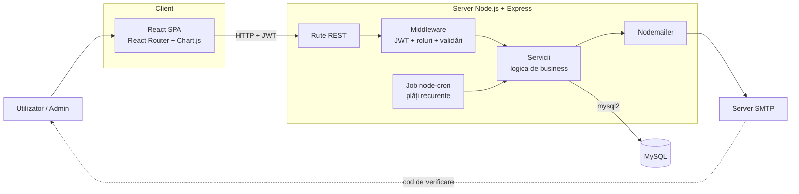
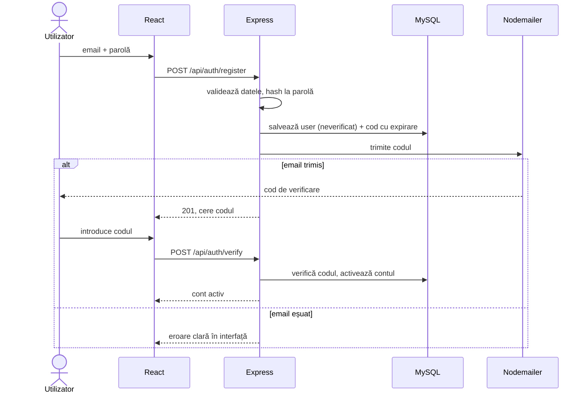
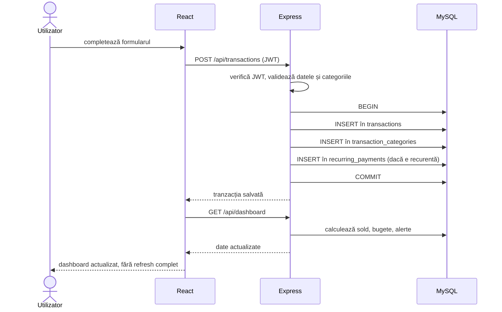

# Arhitectură

Aplicația are 3 straturi: clientul React (SPA), API-ul REST făcut cu Express și baza de date MySQL. Frontend-ul vorbește cu backend-ul doar prin API.

## Diagrama de arhitectură



## Componente

| Componentă | Tehnologie | Rol |
|---|---|---|
| Frontend | React (SPA), React Router, Chart.js | ecranele din wireframes, apelează API-ul |
| API | Node.js + Express | rute REST, validări, logica de business |
| Autentificare | JWT, bcrypt | login, parole hash-uite, middleware pentru roluri |
| Email | Nodemailer | trimite codul de verificare, cu tratarea erorilor |
| Joburi | node-cron | generează zilnic tranzacțiile din plățile recurente |
| Bază de date | MySQL (`mysql2`, fără ORM) | datele din [data-model.md](data-model.md), cu tranzacții SQL |

## Fluxuri principale

### Înregistrare cu cod pe email (UC1)



### Adăugare tranzacție cu categorii multiple (UC2)



## Structura proiectului

```
smartbudget/
├── client/                  # React
│   └── src/
│       ├── pages/           # Login, Dashboard, Tranzacții, Bugete...
│       ├── components/      # navbar, tabele, dialoguri, formulare
│       └── api/             # apelurile către backend
└── server/                  # Express
    └── src/
        ├── routes/          # auth, transactions, budgets, goals...
        ├── middleware/      # JWT, roluri, validări
        ├── services/        # logica de business
        ├── jobs/            # job-ul pentru plăți recurente
        └── db/              # conexiune MySQL, scripturi SQL
```

## Securitate

- Parolele se salvează cu bcrypt, nu în clar.
- Codul de verificare expiră și se poate folosi o singură dată.
- Rutele de după login cer JWT, iar rutele `/api/admin` cer și rol de admin.
- Fiecare utilizator vede doar datele lui: interogările filtrează după `user_id` din JWT.
- Datele sunt validate pe server, nu doar în React.
- Interogările SQL sunt parametrizate, ca să evităm SQL injection.
