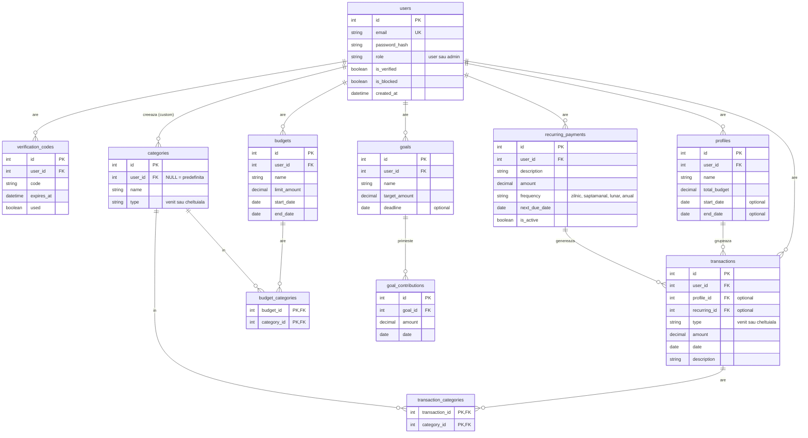

# Model de date și endpoint-uri

Baza de date este MySQL (relațională), cu chei străine între tabele. Legăturile many-to-many (tranzacții-categorii și bugete-categorii) au tabele separate.

## Diagrama ER

## Tabele

| Tabelă | Rol |
|---|---|
| users | conturile, cu rol (user/admin), stare verificat și blocat |
| verification_codes | codurile de la înregistrare, cu expirare și bifă „folosit" |
| categories | categorii predefinite (`user_id` NULL) și custom (`user_id` setat) |
| transactions | veniturile și cheltuielile |
| transaction_categories | legătura many-to-many tranzacții - categorii |
| budgets | limitele de buget, pe perioadă |
| budget_categories | legătura many-to-many bugete - categorii |
| goals | obiectivele de economisire |
| goal_contributions | sumele adăugate la un goal |
| recurring_payments | plățile recurente |
| profiles | profilurile de cheltuieli (opțional) |

## Note importante

- **Plăți recurente:** la `next_due_date` un job generează o tranzacție nouă cu `recurring_id`, apoi mută `next_due_date` la următoarea scadență.
- **Goals:** suma strânsă se calculează din `goal_contributions`, nu se stochează.
- **Bugete:** starea (80% și 100%) se calculează din tranzacțiile din perioadă și din categoriile bugetului, nu se stochează.
- **Categorii multiple:** o tranzacție se salvează împreună cu categoriile ei într-o singură tranzacție SQL, ca să nu rămână date pe jumătate salvate. Validările se fac pe server înainte de salvare.
- **Profiluri:** tranzacțiile cu `profile_id` setat nu intră în statisticile și bugetele generale.

## Endpoint-uri

API REST. După login, utilizatorul primește un JWT, trimis în header (`Authorization: Bearer ...`). Rolul (user/admin) se ia din tabelul `users`. Toate endpoint-urile, în afară de cele din Auth, cer JWT.

### Auth
| Metodă | URL | Descriere |
|---|---|---|
| POST | /api/auth/register | creează contul și trimite codul pe email |
| POST | /api/auth/verify | verifică codul și activează contul |
| POST | /api/auth/resend-code | trimite alt cod |
| POST | /api/auth/login | login cu email și parolă, întoarce JWT |

### Categorii
| Metodă | URL | Descriere |
|---|---|---|
| GET | /api/categories | categoriile predefinite și custom ale utilizatorului |
| POST | /api/categories | adaugă categorie custom |
| PUT | /api/categories/:id | modifică o categorie custom |
| DELETE | /api/categories/:id | șterge o categorie custom |

### Tranzacții
| Metodă | URL | Descriere |
|---|---|---|
| GET | /api/transactions | listă, cu filtre (perioadă, tip, categorie, sumă, căutare) |
| GET | /api/transactions/:id | o tranzacție |
| POST | /api/transactions | adaugă tranzacție, cu mai multe categorii și opțional recurență |
| PUT | /api/transactions/:id | modifică tranzacția |
| DELETE | /api/transactions/:id | șterge tranzacția |

### Bugete
| Metodă | URL | Descriere |
|---|---|---|
| GET | /api/budgets | bugetele, cu suma cheltuită și starea (în limită, atenție, depășit) |
| POST | /api/budgets | creează buget |
| PUT | /api/budgets/:id | modifică bugetul |
| DELETE | /api/budgets/:id | șterge bugetul |

### Goals
| Metodă | URL | Descriere |
|---|---|---|
| GET | /api/goals | goals, cu progresul |
| POST | /api/goals | creează goal |
| PUT | /api/goals/:id | modifică goal |
| DELETE | /api/goals/:id | șterge goal |
| POST | /api/goals/:id/contributions | adaugă o sumă la goal |

### Plăți recurente
| Metodă | URL | Descriere |
|---|---|---|
| GET | /api/recurring | plățile recurente |
| PUT | /api/recurring/:id | modifică suma, frecvența sau scadența |
| PATCH | /api/recurring/:id/status | pune în pauză sau reia |
| DELETE | /api/recurring/:id | șterge plata recurentă |

Plățile recurente se creează din `POST /api/transactions`, cu opțiunea de recurență.

### Dashboard, statistici și export
| Metodă | URL | Descriere |
|---|---|---|
| GET | /api/dashboard | sold, venituri, cheltuieli, bugete, goals, recurente, alerte |
| GET | /api/stats?from=&to= | date pentru grafice (pe categorii și pe zile) și sinteza perioadei |
| GET | /api/export/csv?from=&to= | fișier CSV cu tranzacțiile și sinteza perioadei |

### Profiluri
| Metodă | URL | Descriere |
|---|---|---|
| GET | /api/profiles | profilurile, cu suma cheltuită |
| GET | /api/profiles/:id | detalii, categorii și tranzacții ale profilului |
| POST | /api/profiles | creează profil |
| PUT | /api/profiles/:id | modifică profilul |
| DELETE | /api/profiles/:id | șterge profilul |

### Admin (doar rol admin)
| Metodă | URL | Descriere |
|---|---|---|
| GET | /api/admin/users | lista utilizatorilor |
| PATCH | /api/admin/users/:id/block | blochează sau deblochează |
| DELETE | /api/admin/users/:id | șterge utilizatorul |
| GET | /api/admin/categories | categoriile predefinite |
| POST | /api/admin/categories | adaugă categorie predefinită |
| PUT | /api/admin/categories/:id | modifică categoria predefinită |
| DELETE | /api/admin/categories/:id | șterge categoria predefinită |
