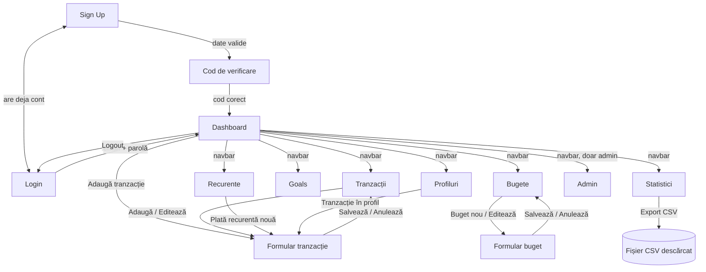

# Wireframes și flux de navigare

## Ecrane

| Fișier | Ecran | Legat de |
|---|---|---|
| [01-signup.html](01-signup.html) | Sign Up + cod de verificare | UC1 |
| [02-login.html](02-login.html) | Login | FR4 |
| [03-dashboard.html](03-dashboard.html) | Dashboard | FR18-FR20 |
| [04-tranzactii.html](04-tranzactii.html) | Listă tranzacții | FR7 |
| [05-tranzactie-noua.html](05-tranzactie-noua.html) | Tranzacție nouă / editare | UC2 |
| [06-bugete.html](06-bugete.html) | Listă bugete | UC3 |
| [06b-buget-nou.html](06b-buget-nou.html) | Buget nou / editare | UC3 |
| [07-goals.html](07-goals.html) | Goals (formulare pe aceeași pagină) | FR16-FR17 |
| [08-recurente.html](08-recurente.html) | Plăți recurente | FR11-FR12 |
| [09-statistici.html](09-statistici.html) | Statistici + export CSV | UC4 |
| [10-profiluri.html](10-profiluri.html) | Profiluri (opțional) | FR26-FR27 |
| [11-admin.html](11-admin.html) | Panou admin | FR24-FR25 |

Formularele mari (tranzacție, buget) sunt pe pagină separată. Cele mici (goal, plată recurentă, profil, categorie admin) sunt pe aceeași pagină. Ștergerea deschide peste tot un dialog „Sigur ștergi?".

## Flux de navigare

Din orice ecran de după login se poate ajunge la celelalte din navbar, de aceea nu am desenat toate săgețile.
